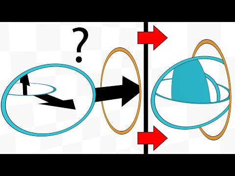

+++
title = "Speeding up a static website"
date = 2021-08-30T00:00:01+00:00
description = "My blog used to load slowly and lag a lot, even though it was a static site. Here is how I got maximum loading speed, minimal traffic and a score of 100 in Lighthouse."

[taxonomies]
tags = ["meta", "blog", "optimization", "zola"]

[extra]
image = "preview.png"
tg = "https://t.me/optozorax_dev/503"
tg_comments = 18

[extra.translation]
from = "ru"
by = "Claude Opus 5.5"
+++

<style>
.speed-bad { color: #ff4e41; } /* 0-49 */
.speed-avg { color: #ffa400; } /* 50-89 */
.speed-good { color: #0dce6b; } /* 90-100 */
</style>

# Introduction

The software world obviously doesn't work as efficiently as it could:
* mobile apps keep getting bigger and bigger,
* traffic and computing power consumption keep bloating for no apparent reason,
* [Electron](https://www.electronjs.org/).

Some people take this too much to heart and start fighting for fast software:
* They use and promote the [Gemini](https://gemini.circumlunar.space/) protocol.
* They disable JS on some sites and demand that sites work without JS.
* They use lightweight alternatives, for example:
	* [Nitter](https://nitter.net/optozorax) — an alternative Twitter frontend.
	* [yewtu.be](https://yewtu.be/channel/UCIsVwdLhYrrs3K8MOXEZdhQ) (running [Invidious](https://github.com/iv-org/invidious)) — an alternative YouTube frontend.
	* [Bibliogram](https://bibliogram.art/) — an alternative Instagram frontend.
	* And there's a whole list of them: [alternative-front-ends](https://github.com/mendel5/alternative-front-ends).

I understand these people and even support them, but not fanatically. I'm also against the bloated web, but I think some things are worth their overhead, for example images and videos, which Gemini rejects. I love it when posts have lots of illustrations: they make reading much more pleasant and easier to follow.

So my optimizations are aimed first of all against bloat, but they won't go as far as me ripping all the images and videos out of the site.

If you're interested in what other features my blog has besides the ones described in this post, you can read the post [New features of this blog](/en/p/new-features/).

## Why I decided to optimize

When I started moving my blog to [Zola](https://www.getzola.org/), I discovered not only the chance to add a bunch of cool new features, but also the chance to optimize: it turns out Zola can resize images automatically. I pulled on that thread, and my appetite grew a lot. I mean, I had reasons to do this before, but the specific trigger was exactly this Zola feature.

# Tools

To find out how fast my site loads and runs, I use:
* Common sense.
* The Console and Network tabs in the developer tools.
* [PageSpeed Insights](https://developers.google.com/speed/pagespeed/insights/).

The last tool analyzes your page for mobile and desktop and suggests every possible way to improve performance along the way. I prefer the web version over the Lighthouse built into Chrome, so that I test under production conditions right away.

# Optimizing internal requests

## Image optimization

Zola has the [`resize_image`](https://www.getzola.org/documentation/content/image-processing/) function, which can re-encode a given image to a different resolution, a different format and a lower quality. I started using it in my posts:
* I downscale to a maximum size of 1280×1280
* Format `webp`
* Quality `75/100`

I chose `webp` because it's a more modern format, made specifically for the web: it compresses better than `jpg` and doesn't look as crunchy. It also supports transparency, so you can safely convert `png` to it. It's [not supported everywhere](https://caniuse.com/webp), though, but I think we can live with that(?).


In my posts I insert images into markdown not with ``, but with the `image.html` shortcode:
```zola
{{ image(path="my_image.jpg") }}
```


Some examples of how the sizes changed:

|Comment|Old format|Old resolution / 1280|Old size|New size|Compressed N times|
|-|-|-|-|-|-|
|A photo of my keyboard|jpg|×1.3|533 KB|39 KB|×13.7|
|An image of the most complex layer of my layout|png|×2.3|333 KB|27 KB|×12.3|
|A screenshot of a monoportal|png|×1.4|314 KB|34 KB|×9.2|
|A photo of the Planck keyboard|jpg|×1|47 KB|25 KB|×1.9|
|A street photo|jpg|×1|219 KB|239 KB|×0.9|

The overall trend is clear: for large images, bigger than 1280, the traffic savings are huge. `png` images also come out great. Sometimes it doesn't work out so well, as with the street photo, but that's rare and not critical. And all this at the cost of only minor changes in quality.

Any image can be opened in its original size and original format if you want to see more detail. More on that in my post [about the blog's new features](/p/new-features).


My folders contain 50 MB of `jpg` and `png` images, and the processed result in `webp` format weighs 11 MB.

That's **≈5 times** less!



on the home page every post has an image on the side, so that it's not only the titles that catch your eye.

Previously, these small images were requested in their original huge resolution, so the home page could take a long time to load and really weighed a lot.

Now, with this image optimization feature, I resize the images specifically for the home page to a maximum resolution of 200×200, and now the home page loads instantly, even with all the images.

Without this feature in Zola I definitely wouldn't have bothered so much with small images.


## Video optimization

HTML5 has the `<video>` tag, which lets you embed video playback without any hacks or JS. I sometimes use it to put videos in my posts.

Videos shouldn't have too high a resolution either. For example, you shoot in 4K on your phone: why keep that quality on your page and waste traffic for nothing? Especially if the video is just a small demo clip.

Also, videos have to be encoded in a particular way so that they play in all browsers and on all devices.

I convert videos with [`ffmpeg`](https://www.ffmpeg.org/) using the following script:

```bash
#!/bin/bash

# First argument: input file (may be another video, gif or folder with pictures,
# read ffmpeg docs).
#
# Second argument optional: quality. for default it is 35 (averagely bad 
# quality), you can provide 22 as nice quality.
#
# Third argument optional: can be "mute" to mute or anything else to not to.
#
# Out is file with `_web` postfix and `mp4` format scaled down to 1280 max 
# width or height or not scaled if initial size is smaller
# 
# Command get from https://gist.github.com/jaydenseric/220c785d6289bcfd7366

filename=$(basename -- "$1")
extension="${filename##*.}"
filename="${filename%.*}"
path="${1%/*}"

if [ ${3:-"preserve_audio"} == "mute" ]
then
	audio="-an"
else
	audio="-c:a aac -strict experimental"
fi

ffmpeg -y \
       -i $1 \
       -c:v libx264 \
       -pix_fmt yuv420p \
       -profile:v baseline \
       -level 3.0 \
       -crf ${2:-35} \
       -preset veryslow \
       -vf "scale=ceil(iw*min(1\,1280/iw)/2)*2:ceil(ow/dar/2)*2" \
       ${audio} \
       -movflags +faststart \
       -threads 0 \
       ${path}/${filename}_web.mp4
```

The arguments and the script's source are described in its comments, so help yourself. The resulting video is optimized for the browser and also works on phones. A naive `mp4` simply won't play on a phone.


No exact measurements here, but rest assured that the savings are big too, and most importantly, the videos will play everywhere.



You can also convert videos to the AV1 codec, since it's more modern, faster and better; but it isn't supported everywhere, and you need to provide `mp4` fallbacks, so I didn't bother with it.

On this topic you can read Andrey Sitnik's article ["The new AV1 codec: speeding up video loading in the browser"](https://habr.com/ru/post/442020/) (in Russian).


## Converting gif to video

`GIF` is a horribly outdated format. Everything about it is bad: compression, encoding/decoding speed and the number of colors. So you shouldn't use `gif` directly; it's better to re-encode it into a video and embed the video with the right parameters so that it plays like a gif.

For the conversion I use the script from the previous section; it works with gifs too.


To insert videos as gifs, I use the `video_gif.html` shortcode:
```zola
{{ video_gif(path="my_gif_web.mp4") }}
```



All the `gif`s weigh 84 MB, and the processed result in `mp4` format weighs 10 MB.

That's **≈8.4 times** less!!!


# Optimizing external requests

The whole point of this section is to cut the number of requests to external sites down to zero. Requests to external sites aren't made right away and can take a long time, so it's better to optimize them as much as possible.

## Fonts

These days everyone uses [Google Fonts](https://developers.google.com/fonts/docs/getting_started) to add fonts to their site, simply by adding this to `<head>`:
```html
<link rel="stylesheet" href="//fonts.googleapis.com/css?family=Open+Sans:300,400,600,700&amp;lang=en" />
```

But in that case, first a request goes to Google, and then the fonts listed in the received document are downloaded from Google again. Why do that every time, if in 99% of use cases your site will have the same font?

So I simply downloaded the corresponding `css` and font files locally for all the fonts I use.

I don't think I've ever heard of a license forbidding this.

## JS and CSS

I use [hammerjs](https://hammerjs.github.io/) and [KaTeX](https://katex.org/). They require including extra JS code, and the second one also needs CSS with custom fonts.

When people include scripts like these, they just link to some external site that hosts them. With my Kazakhstani internet, one site took forever to load because of `jquery`, which was downloading very slowly from some external source.

They even add a hash in the `integrity` attribute to guarantee that exactly the right script arrives:
```html
<script 
	defer 
	src="https://cdn.jsdelivr.net/npm/katex@0.10.0/dist/katex.min.js" 
	integrity="sha384-K3vbOmF2BtaVai+Qk37uypf7VrgBubhQreNQe9aGsz9lB63dIFiQVlJbr92dw2Lx" 
	crossorigin="anonymous"></script>
```

And again, why all these delays and hashes, if you can simply download it all locally?

## YouTube

Okay, the jokes are over, time to get to the serious stuff.

We all know that YouTube videos can be embedded like this:

{{ <image path="embed.png" scale="2/3" /> }}

But behind this lies the main horror of this post...

Honestly, at first I didn't even suspect that YouTube was such a sinner. I only noticed that it eats a lot of traffic and slows down my pages thanks to **Google's own** [PageSpeed Insights](https://developers.google.com/speed/pagespeed/insights/) tool!

I measured it, and on my pages with a couple of YouTube videos it added **2 megabytes** of extra traffic. And that's when my biggest and heaviest page, the one about [my keyboard layout](/en/p/my-keyboard-layout/), weighs 3.8 megabytes after image optimization. So for the other pages this is simply unacceptable overhead, and it means that all my previous steps are just a drop in the ocean compared to what YouTube adds.

And when I tried to measure the [Emergevolution](/en/e/emergevolution/) page, which had 37 embedded videos, [PageSpeed Insights](https://developers.google.com/speed/pagespeed/insights/) simply refused to give a report. Apparently it couldn't download everything.

So this absolutely has to be optimized. And there are several options here.

### The simplest way to embed a YouTube video

[Insert an image that links to the video](https://stackoverflow.com/questions/11804820/how-can-i-embed-a-youtube-video-on-github-wiki-pages):
```md
[](https://www.youtube.com/watch?v=YOUTUBE_VIDEO_ID_HERE)
```

It looks like this:

<a href="https://www.youtube.com/watch?v=1q0sHf_n_2Y"></a>


* Cheap and cheerful
* Fast
* Little traffic


* Ugly
* It's not obvious that this image belongs to a video
* It's not obvious that you can click it to go to the YouTube video
* No information about the video title and the channel


### My way

So I made my own YouTube embed ~~with blackjack and...~~, which works in several stages.


In my posts I use the `youtube.html` shortcode:
```zola
{{ youtube(id="1q0sHf_n_2Y") }}
```

On top of that, I download the metadata and the thumbnail locally. There's more on this in the [post about the features](/p/new-features/#embedding-youtube).


And then it looks like this:

{{ <myyoutube id="1q0sHf_n_2Y" /> }}

It's just a piece of HTML with a locally downloaded image and metadata. Clicking it opens the corresponding video in a new tab. You can also click the channel to go straight to it. Unfortunately, `youtube-dl` can't get the channel's avatar, so the channel is just written as text here.

I decided to add the video's duration here, which even the regular YouTube player doesn't show! I think that's a pretty fair trade for losing the author's avatar.


As the results here, I'll give the scores from [PageSpeed Insights](https://developers.google.com/speed/pagespeed/insights/).

The "Before YouTube optimization" column shows the results when images, gifs and videos are already optimized, and fonts and scripts are already downloaded locally.

The "After YouTube optimization" column shows the results after optimizing YouTube this way and preloading fonts (more on that later).

The table cells contain, in order:
* the mobile score;
* the desktop score;
* the page weight together with the loaded resources.

|Page|Comment|Before YouTube optimization|**After YouTube optimization**|
|-|-|-|-|
|[Portals](/portals)|Lots of `<video>` and images, the page is fairly large, and only 2 YouTube videos are embedded.|<span class="speed-bad">42</span>; <span class="speed-avg">60</span>; 4.9 MB|<span class="speed-avg">61</span>; <span class="speed-good">91</span>; 2.8 MB|
|[Emergevolution](/emergevolution)|37 YouTube videos embedded.|Google choked on it|<span class="speed-good">97</span>; <span class="speed-good">99</span>; 2.8 MB|

Now the page that Google itself couldn't manage to measure shows incredibly high scores. I think it was clearly worth it.

And you can also see that the portals page shed **2.1 MB of traffic**.



If you put YouTube itself into [PageSpeed Insights](https://developers.google.com/speed/pagespeed/insights/), you get these scores: <span class="speed-bad">32</span>; <span class="speed-bad">43</span>; 1.3 MB.


## Other embeds

On my blog I also occasionally embedded posts from Telegram and Twitter. Inventing something of my own here, like with YouTube, just doesn't make sense. So here I simply insert a screenshot of the embed. For example, for Twitter:


{{ <image path="twitter_1415392339586129928.png" scale="2/3" /> }}


A dumb solution, but it works well. And even if the original tweet gets deleted, the information from it will stay on my blog!

And a wall of text can be inserted as plain text, as for example [here](/p/how-i-write-programs/#vazhnee-chto-to-ne-delat).


When you embed a Telegram post, a non-minified script is requested.


# Optimizing request depth

Nothing special here: [PageSpeed Insights](https://developers.google.com/speed/pagespeed/insights/) just scolded me that my `.woff2` font files themselves aren't downloaded right away when the page loads, but only after the `main.css` file is downloaded. That is, the fonts have a depth of 2. It also suggested adding this to my page:

```html
<link rel="preload" as="font" href="/fonts/Rubik/iJWKBXyIfDnIV7nFrXyi0A.woff2" crossOrigin="anonymous">
```

I didn't even suspect that request depth was something you could optimize. I hope you find this useful, and I hope my blog now loads at least a few milliseconds faster.

# Optimizing nice-to-haves

One obstacle on the way to optimization is our nice-to-haves. For example, while reading the YouTube section, you might have thought: "well yes, it loads faster, but now you have to open the video in a new tab and watch it there, you can't watch it right on the site", or "you can't click the 'Watch later' button". Another problem with local embeds is that if the original video or post changes, my copy won't reflect it.

Yes, these are real downsides. I can't say anything here except that **you have to cut down on nice-to-haves**. Personally, I think these conveniences aren't worth their downsides.

If you manage to tame your desires and make compromises, you can optimize a lot.

On this point I want to refer to my post ["How I write programs", section "Discard complex features right away"](/p/how-i-write-programs/#srazu-otbrasyvat-slozhnye-fichi). In that section I tell how I cut down on my nice-to-haves and managed to quickly write a program that I now use actively.

# What isn't optimized

## Yandex.Metrica

Since I don't host the blog myself, I have no other way to measure how many visitors I have, which post was viewed the most, and so on. And I can't do without that: how else am I supposed to get my well-deserved dopamine?

[PageSpeed Insights](https://developers.google.com/speed/pagespeed/insights/) complains about Yandex.Metrica, but unfortunately I'll have to live with this evil for now.

I'm planning to move from Yandex.Metrica to my own server with [Plausible](https://plausible.io/). It's open-source analytics whose JS script weighs less than 1 KB. It's also as anonymous as possible and doesn't use cookies.

## GitHub Pages

[PageSpeed Insights](https://developers.google.com/speed/pagespeed/insights/) also complained a lot that the resource cache lifetime is set to a measly 10 minutes. That is, you visit the site, download the styles, scripts and fonts, and 10 minutes later you have to download them again.

This is a drawback of [GitHub Pages](https://pages.github.com/), where I host this blog. It can't be configured. So here it's better to move to your own server, or look for an alternative such as:
* [Sourcehut Pages](https://www.getzola.org/documentation/deployment/sourcehut/)
* [Netlify](https://www.getzola.org/documentation/deployment/netlify/)
* [GitLab Pages](https://www.getzola.org/documentation/deployment/gitlab-pages/)
* [Vercel](https://www.getzola.org/documentation/deployment/vercel/)
* [Cloudflare Pages](https://www.getzola.org/documentation/deployment/cloudflare-pages/)

Or I'll just buy a server and host the blog on it with nginx.

# The JS I use

By the standards of the modern web, you could say I hardly use JS at all. There's an opinion that JS is bad because it slows pages down and lets sites track users. If you disable JS, my blog is quite usable, except for a few things:
* Galleries can't be flipped through. Here I already [want to make a gallery in pure CSS](/p/new-features/#chistyi-css).
* You can't open images in full resolution. Some hack with `<a href="">` that doesn't get in the way of the normal behavior could work here, but I need to think about it.
* The table of contents can't be scrolled and doesn't scroll automatically. Sorry, folks, unfortunately this just can't be done without JS (or it can, but I don't know something, or haven't done enough research).
* Math formulas won't render. I don't like that JS is used here either; I'd like the math to be parsed when the site is generated, but Zola has no features for this yet. And generating `svg` images in advance is quite complicated and inconvenient.

If you'd like to make a Pull Request that lets one of these things work without JS, I'll be happy to accept it!

# Conclusion

## Final numbers

So, what did I gain from all this optimization?


Here are the dry numbers from the sections above:
* Images are **≈5 times** smaller.
* Gifs are **≈8.4 times** smaller.
* YouTube videos: **2.1 MB** saved on a single page.



And once again, the [PageSpeed Insights](https://developers.google.com/speed/pagespeed/insights/) scores and the page size.

I'll compare against my old blog with absolutely no optimizations, where:
* Regular videos were already optimized.
* Images weren't resized automatically.
* Gifs were actual `gif` files.
* The font was loaded from Google, not downloaded locally.
* MathJax was used, loaded from an external site (now it's [KaTeX](https://katex.org/), stored locally).
* YouTube was embedded directly, or inserted with [the image approach](#the-simplest-way-to-embed-a-youtube-video).
* Yandex.Metrica was used.

|#|Page|What this page tests|Before optimization|**After optimization**|
|-|-|-|-|-|
|1|[Home page](/)|Post preview images were requested in their original resolution.|<span class="speed-bad">49</span>; <span class="speed-good">95</span>; 3.6 MB|<span class="speed-good">100</span>; <span class="speed-good">100</span>; 460 KB|
|2|[A notation for linear algebra](/p/linear-algebra/)|Lots of math formulas, which need special scripts, styles and fonts.|<span class="speed-avg">56</span>; <span class="speed-avg">75</span>; 429 KB|<span class="speed-avg">86</span>; <span class="speed-good">100</span>; 363 KB|
|3|[Portals](/p/portals/)|Lots of `<video>` and images, 2 embedded YouTube videos.|<span class="speed-bad">27</span>; <span class="speed-avg">64</span>; 12 MB|<span class="speed-avg">61</span>; <span class="speed-good">91</span>; 2.7 MB|
|4|[Ilya Sheprut's keyboard layout](/p/my-keyboard-layout/)|My biggest post, with tons of images.|<span class="speed-bad">12</span>; <span class="speed-bad">46</span>; 25 MB|<span class="speed-avg">65</span>; <span class="speed-good">97</span>; 3.4 MB|
|5|[Emergevolution](/e/emergevolution/)|Lots of embedded videos. Though in the old version they weren't embedded, just inserted as images.|<span class="speed-avg">69</span>; <span class="speed-avg">88</span>; 5.1 MB|<span class="speed-good">97</span>; <span class="speed-good">99</span>; 2.8 MB|
|6|[About my Space Objects library and the Pythagoras tree](/p/space-objects/)|Lots of heavy gifs.|<span class="speed-avg">62</span>; <span class="speed-good">97</span>; 47 MB|<span class="speed-avg">87</span>; <span class="speed-good">99</span>; 12 MB|

Conclusions for each page:
* `1`, `3`, `4`: shrinking the images does its job, cutting megabytes dramatically.
* `2`: thanks to downloading fonts, styles and scripts locally, it now loads much better.
* `3`, `4`: since there's no YouTube embed anymore, the stats are better.
* `5`: the page with 37 YouTube videos gets the best scores after the home page, thanks to storing the metadata and thumbnails locally.
* `6`: the gif optimization pays off nicely, the size changes a lot, but the final size is still large.



Sorry, I measured all the pages of the new blog without Yandex.Metrica, and the old blog with it. It lowers the scores a bit. For example, with it, item `4` on the new blog gets: <span class="speed-avg">50</span>, <span class="speed-avg">81</span>, 3.4 MB.

So the results here aren't entirely fair. Re-measuring everything properly at this point would be too much work. And since I'm going to leave Yandex.Metrica soon anyway, these results can be considered the planned ones.


## Takeaways

* I made my blog as fast as possible.
* I got rid of **all** external requests: now, to read my blog, you only need access to the blog itself.
* In the process I didn't lose a single important feature.
* Embedding YouTube is cancer.
* Use [Zola](https://www.getzola.org/), because its image resizing is fire.

As for why speed matters, I also want to refer to the post ["Stand under the boom"/64](https://t.me/nikitonsky_pub/64) (in Russian). It's not entirely relevant, since it talks about software and I have a blog, but the general idea fits.

And finally, a meme:


{{ <image path="future_meme.en.jpg" scale="2/3" /> }}

