+++
title = "Properties of reversible 1D automata"
date = 2021-07-28
description = "I study the properties of one-dimensional reversible cellular automata and find trivial transformations and 4 groups of automata."

[taxonomies]
tags = ["math", "cellular-automata", "programming", "reversible-automata"]

[extra]
image = "preview.png"
tg = "https://t.me/optozorax_dev/484"
tg_comments = 59

[extra.translation]
from = "ru"
by = "Claude Opus 5.5"
+++

# Introduction

This article assumes that you already know what a cellular automaton is and are familiar with Rule `110` or Rule `30`.

If not, I recommend reading these two articles:
* [The simplest cellular automata and their practical applications](https://habr.com/ru/post/273393/) (in Russian)
* [$30,000 for solving problems about Rule 30 for cellular automata — a contest by Stephen Wolfram](https://writings.stephenwolfram.com/2019/10/announcing-the-rule-30-prizes/)

It also assumes that you know what a **reversible** cellular automaton is. If not, I recommend reading this Wikipedia article:
* [Critters](https://en.wikipedia.org/wiki/Critters_(cellular_automaton))

I also wrote about reversible automata in my Telegram channel (in Russian), starting here: [optozorax_dev/235](https://t.me/optozorax_dev/235), 7 posts in total.

# Table of automata

In this article, much like in the ones above, I want to look at one-dimensional cellular automata, but reversible ones, and figure out their properties.

There are many ways to get reversible cellular automata, but I'll pick the one Critters is built with, namely the Margolus neighborhood. In the one-dimensional case it is 2 bits in size, so the number of possible states is 2² = 4, and the number of possible rules is 2²! = 24.

You can see all these automata in the table below. Each one starts with a random row of zeros and ones whose end wraps around to its beginning. Then the rules of the automaton are applied to it, and each resulting row is appended to the bottom of the picture. So in the pictures time runs downward, while space runs left and right. The number of the automaton (from 0 to 23) is written above, and its rule, that is, a permutation of the numbers `[0, 1, 2, 3]`, is written below.

<b>0</b> 
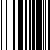

[0 1 2 3]

<b>1</b> 
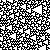
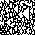
[0 1 3 2]

<b>2</b> 

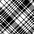
[0 2 1 3]

<b>3</b> 

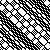
[0 2 3 1]

<b>4</b> 
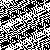
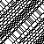
[0 3 1 2]

<b>5</b> 
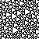
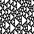
[0 3 2 1]

<b>6</b> 
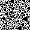
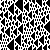
[1 0 2 3]

<b>7</b> 

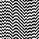
[1 0 3 2]

<b>8</b> 

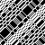
[1 2 0 3]

<b>9</b> 
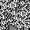
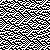
[1 2 3 0]

<b>10</b> 

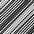
[1 3 0 2]

<b>11</b> 

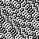
[1 3 2 0]

<b>12</b> 
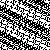
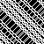
[2 0 1 3]

<b>13</b> 
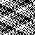
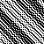
[2 0 3 1]

<b>14</b> 
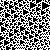
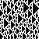
[2 1 0 3]

<b>15</b> 
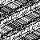
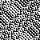
[2 1 3 0]

<b>16</b> 

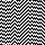
[2 3 0 1]

<b>17</b> 
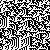
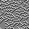
[2 3 1 0]

<b>18</b> 
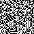
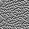
[3 0 1 2]

<b>19</b> 

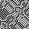
[3 0 2 1]

<b>20</b> 
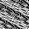
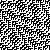
[3 1 0 2]

<b>21</b> 

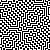
[3 1 2 0]

<b>22</b> 
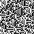
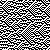
[3 2 0 1]

<b>23</b> 

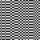
[3 2 1 0]

Since the Margolus neighborhood requires applying the rules starting from even cells on even steps and starting from odd cells on odd steps, I added a way to turn the display of odd steps on and off. Some automata behave identically on even steps, for example `0` ~ `23`, `2` ~ `10` ~ `13` ~ `21`. You can toggle it here: 

<label><input type="checkbox" id="img_intermediate" name="img_intermediate" checked>&nbsp;Show odd steps</label>

# Various properties

The table can also show various properties of the automata. Pick a property and scroll up: the automata that have it will be highlighted in red.

<form name="properties_radio">
<label><input type="radio" name="prop" value="all" checked > No property</label> 
<label><input type="radio" name="prop" value="trivial" /> Preserve the current state</label> 
<label><input type="radio" name="prop" value="trivial_two" /> Repeat the state every two steps</label> 
<label><input type="radio" name="prop" value="self_mirror" /> Mirroring the rule gives the same rule</label> 
<label><input type="radio" name="prop" value="save_count" /> Preserve the number of filled cells</label> 
<label><input type="radio" name="prop" value="time_symmetricale" /> Same laws for simulating backward and forward in time</label> 
<label><input type="radio" name="prop" value="anti_time_symmetricale" /> The rule for simulating backward in time equals the current one with inverted colors</label> 
<label><input type="radio" name="prop" value="self_inverse" /> Inverting the colors of the rule gives the same rule</label> 
</form>

All properties are computed for automata over 2 steps, that is, after an even and an odd step. I don't think it's very useful to evaluate the properties of an automaton after 1 step without knowing whether the previous step was even or odd: there are too many variants, and almost no properties are left. I'll explain some of the properties below:

The most boring automata are the ones that **preserve the current state**. These are automata `0` and `23`. They do nothing.

Slightly less boring are the automata that **repeat the state every two steps**. Relative to the current step, their step into the past and their step into the future must be the same. As a result, they return to the initial state after at most 4 steps. This adds two more automata: `7` and `16`.

Slightly less boring still are the automata that **map to themselves when mirrored**. That is, they can't tell left from right. Here `2` and `21` join the trivial `0` and `23`.

**Same laws for simulating backward and forward in time**: I think this property is analogous to [T-symmetry](https://en.wikipedia.org/wiki/T-symmetry), although I don't know how fair it is to draw such analogies. This includes the triangle-forming `1` and the automata derived from it (we'll see this later).

**The rule for simulating backward in time equals the current one with inverted colors**: the same as the previous property, only inverted. This property is interesting because Critters is exactly such a rule. That is, if you invert the whole grid in Critters, gliders will appear that consist of empty cells instead of filled ones, and these gliders will move backward in time rather than forward.

**Inverting the colors of the rule gives the same rule**: the interesting ones here are automata `10` and `13`, because they have no other special properties.

Let's list the non-trivial automata that have a unique property of their own:
* `{1, 5, 6, 14}` can't tell the direction of time.
* `{9, 17, 18, 22}` move backward in time when the colors are inverted.
* `{2, 21}` can't tell left from right.
* `{10, 13}` can't tell white from black.

# Beautiful automata

* `1` is similar to Rule `30` of ordinary automata: it also forms triangles, only rotated by 90°.
* `2` looks like a shirt pattern.
* `21` looks like the [Tron rule](https://en.wikipedia.org/wiki/Block_cellular_automaton#Tron).

<b>1</b> 

<b>2</b> 

<b>21</b> 

# Deriving rules

If you go back to the beginning and look at all the automata, you'll notice that for automaton `1`, `5` is its mirror image, `6` is its inversion, and `14` is both its inversion and its mirror image.

<b>1</b> 

<b>5</b> 

<b>6</b> 

<b>14</b> 

So one may wonder: which automata can be derived from which by various operations on rules?

## Trivial derivations

Let's take the rule transformations about which we can say for sure: yes, this is the same rule, just a little different.
* Swap left and right. Shown in green.
* Invert white and black. Shown in red.
* Invert the rules so that they simulate backward in time. Shown in black.

Then all the rules have the following connections:

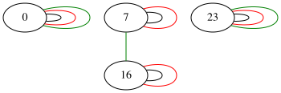
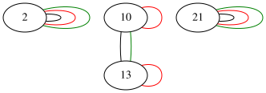
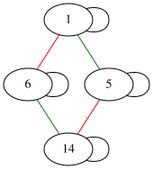
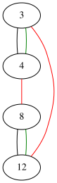
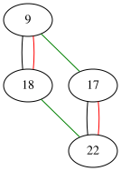
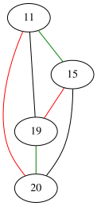

Something is wrong here. For some reason `0` and `23` aren't connected at all, and neither are `2` and `21`, even though they are the same if you skip odd steps:

<b>0</b> 

<b>23</b> 

<b>2</b> 

<b>21</b> 

On the other hand, automata `1`, `5`, `6`, `14` are connected to each other, which is nice.

So we need to come up with one more operation for deriving new rules, so that the others can be connected too.

## Half-inversion

Let's add an operation implemented by half-inversion. If a rule is written in the form `[00, 01, 10, 11] → [11, 01, 00, 10]`, then ordinary inversion inverts the bits on both sides, while half-inversion inverts them only on the right side. We'll show it in purple. Then our graphs look like this:

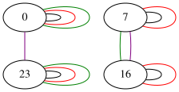
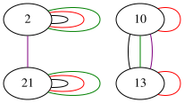
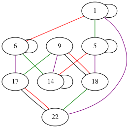
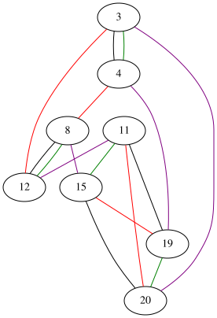

Here's an interesting thing. The cluster of rules derived from `1` got connected to the cluster of rules derived from `22`. And they are indeed quite similar:

<b>1</b> 

<b>22</b> 

And the cluster of rules derived from `3` got connected to the cluster derived from `20`. They look alike when odd steps are skipped:

<b>3</b> 

<b>20</b> 

If you look at how the new operation connects rules, you can say that it simply computes `23-x`. That is, with this operation we can get any rule from `12` onward if we know all the rules up to 11. That's good, because we can throw away half of the rules, knowing that this half is symmetric to the first half under half-inversion.

But rules `2` and `10` are still not connected, even though they are simply identical without odd steps:

<b>2</b> 

<b>10</b> 

## The strange operation

I couldn't find any combination of time reversal, mirroring, inversion, their half versions and all their combinations that would connect rules `2` and `10`. The only thing I found is this operation: swap elements 0 and 1 and swap elements 2 and 3 in the rule array (written in square brackets in the table). Let's call it the **strange operation** and show it in cyan.

Then we get the following set of graphs:

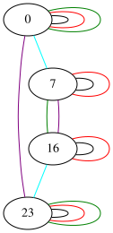
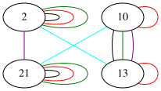
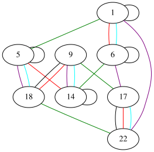

Hooray! Now the trivial automata `{0, 7, 16, 23}` are connected, and so are the slightly more complex but still very simple `{2, 10, 13, 21}`. As for the other automata, nothing special happened to them. Whatever was already connected by the previous operations stays connected by them.

So in total we get 4 groups of automata that can be obtained by fairly simple operations that don't change the behavior of an automaton much. You could say that if we study the properties of automaton `1`, then in principle we can extrapolate its properties, taking half-inversion into account, to automaton `22`.

I don't like this **strange operation** at all, though. Because I don't understand what happens if you generalize it to:
* Automata with a larger block size (3 or more)
* Automata with more colors (3 or more)
* Automata with more dimensions (2 or more)

So if you have any ideas what to do with it, let me know.

# 2D time

The next study of properties was inspired by an article about how to create 2D time for irreversible cellular automata:
* [CELLULAR AUTOMATA WITH 2 TEMPORAL DIMENSIONS](http://dmishin.blogspot.com/2014/06/cellular-automata-with-2-temporal.html)

There the author proposes the idea of 2D time, which requires two functions \\(f, g\\) that give the same result regardless of the order in which they are applied: \\(f(g(x)) = g(f(x))\\). So we can check all the automata and find out which ones commute with which. First of all, I should say that automata `{0, 23, 7, 16}` commute with everything, and they are completely trivial and uninteresting, so I excluded them from the graph. And I got the following result:

Only rules from the groups derived from `2` and `3` are involved here, and there are no automata derived from the triangle-forming `1`, which is rather sad.

The result is roughly the same as in that article: apart from the trivial ones, only fairly boring automata commute with each other.

The idea of drawing graphs between rules was inspired by this article:
* [GRAPH OF COMMUTING ELEMENTARY CELLULAR AUTOMATA](http://dmishin.blogspot.com/2016/01/graph-of-commuting-elementary-cellular.html)

To find out whether two rules commute or not, I simply take a very long string of 10k bits and check the formula `f(g(x)) = g(f(x))` on that one string. So my results aren't perfect, but the probability of an error is extremely low.

# Source code

The source code for computing the pictures, properties and graphs for this article is in the repository [optozorax/time_2d_inversible_automata](https://github.com/optozorax/time_2d_inversible_automata).

# Future work

I think there should be very interesting rules among:
* Reversible one-dimensional automata with **3** colors and block size **2**
* Reversible one-dimensional automata with **2** colors and block size **3**

In the first case there are 3²! = 362_880 automata, and in the second 2³! = 40_320, which is also a lot...

This will require writing software to find connected components in the graphs. And doing more thinking. But I think the number of groups from which everything else can be derived shouldn't be that large. After that, the groups can be studied for commutativity. Maybe among these variants there are interesting rules that allow two-dimensional time.

